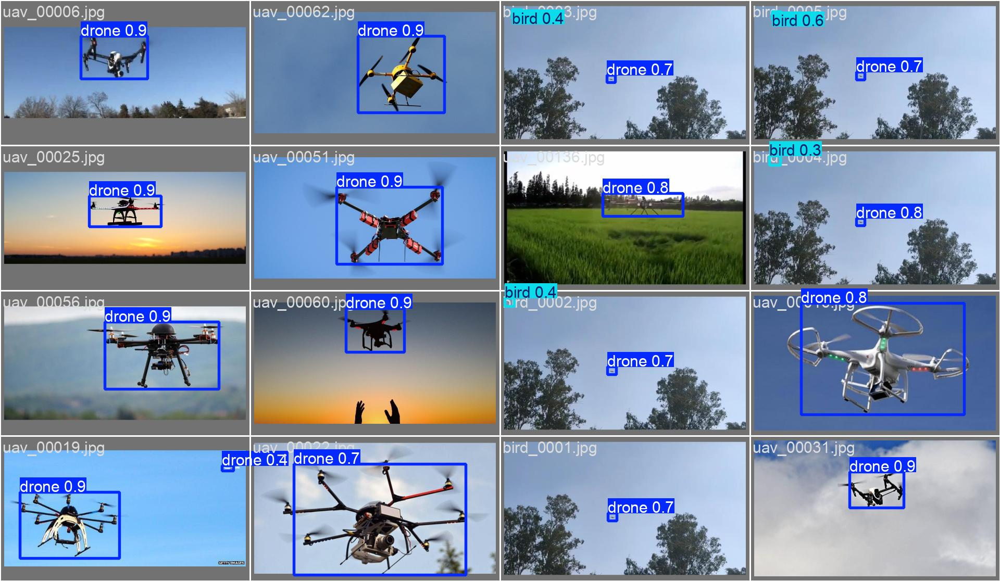

# YOLO Drone Detection (yolo26s_960_with_cocco)

Detekcja dronow (drone) oraz ptakow (bird) z wykorzystaniem modelu YOLO26s (imgsz=960, 50 epok) na zbiorze local_fast_dataset_960_with_cocco.

## Struktura repozytorium
- configs/drone.yaml - konfiguracja datasetu i klas
- src/train.py - skrypt treningowy
- weights/best.pt - najlepsze wagi modelu
- results/metrics.json - podsumowanie metryk koncowych (50. epoka)
- results/sample_pred.jpg - przykladowa predykcja modelu

## Wyniki (50. epoka)
| Metryka | Wynik |
| :--- | :--- |
| mAP50 | 0.9579 (95.79%) |
| mAP50-95 | 0.6653 (66.53%) |
| Precision | 0.9498 (94.98%) |
| Recall | 0.9369 (93.69%) |

## Przykladowa detekcja


## Jak uruchomic
```bash
pip install -r requirements.txt
python src/train.py
```

Inferencja na wytrenowanych wagach:
```bash
yolo predict model=weights/best.pt source=twoj_obraz.jpg imgsz=960
```
